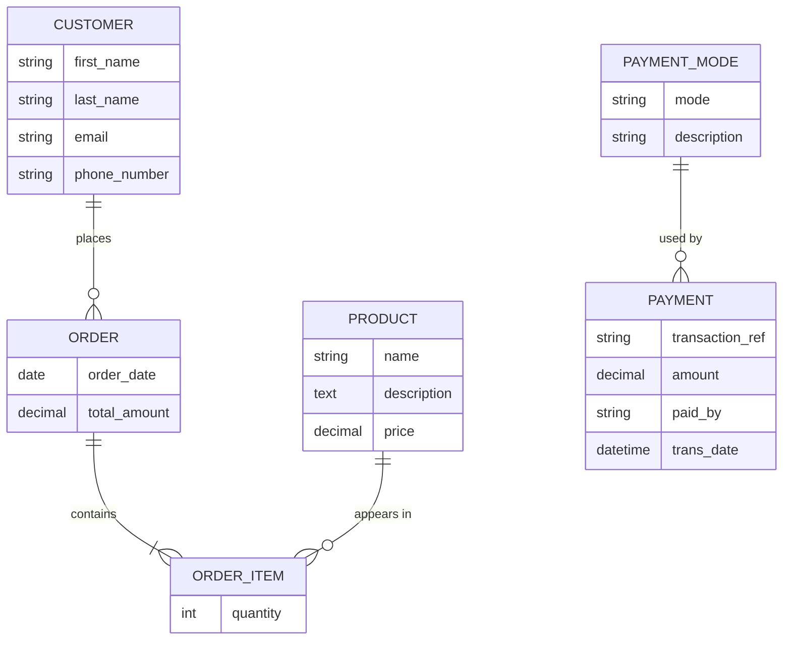

# Afyastore

A Django back-office application for running a small store: managing customers, products, orders and payments from one place.


---

## Modules

The project is split into three Django apps, each owning one part of the business:

| App | Responsibility |
|---|---|
| `customers` | Customer records with unique email and contact details |
| `ordermanagement` | Product catalogue, orders, and order line items |
| `payments` | Payments with transaction references, amounts and configurable payment modes |

## Data model



Orders and products are linked through an explicit `OrderItem` model, so each line item carries its own quantity.

## Routes

| Path | Description |
|---|---|
| `/admin/` | Django admin for all models |
| `/customers/` | Customer list |
| `/ordermgmt/products/` | Product catalogue and product detail pages |
| `/ordermgmt/orders/` | Orders and order detail pages |
| `/payments/add_payment/` | Record a payment |
| `/payments/all/` | All payments |
| `/payments/<id>/` | Payment detail |

## Getting started

```bash
git clone https://github.com/eugeneaondo/Afyastore.git
cd Afyastore

python -m venv .venv
source .venv/bin/activate        # Windows: .venv\Scripts\activate
pip install "django>=4.2,<5"

python manage.py migrate
python manage.py createsuperuser
python manage.py runserver
```

Open `http://127.0.0.1:8000/admin/` and sign in with the superuser you created.

## Roadmap

- [ ] Link payments directly to orders
- [ ] Order totals calculated from line items
- [ ] Stock tracking on products
- [ ] Mobile money payment integration
- [ ] Move configuration and secrets to environment variables
